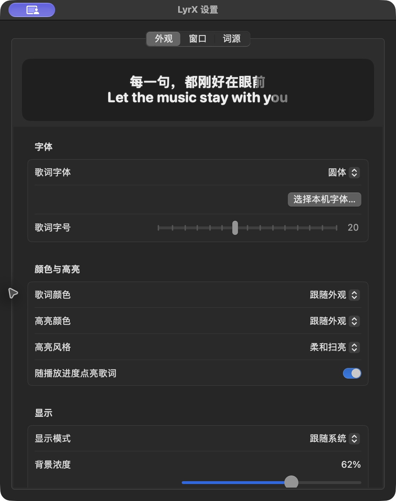

  

# LyrX

为 Apple Music 打造的 macOS 桌面悬浮歌词第三方工具。让歌词跟随音乐融入桌面。

支持 **macOS 14 及以上版本、Apple Silicon Mac**。

## 功能

- **悬浮歌词**：歌词自动跟随，支持置顶、跨桌面显示、窗口缩放与拖动。
- **简洁外观**：跟随系统、浅色、深色和透明主题；精简模式只显示歌词，可搭配鼠标穿透。支持自选字体、歌词与高亮配色，设置会自动保存。
- **逐句与逐字高亮**：有逐词时间时按词点亮；只有逐句时间时，可选择估算的句内进度或整句高亮。
- **灵活词源**：自动匹配多词源；可读取 Apple Music 本地歌词（需授权）、导入 LRC / TXT。Musixmatch 为需要自行配置密钥的可选来源。
- **播放与启动**：显示专辑封面，控制上一首、播放／暂停和下一首；可随登录 Mac 时自动启动。

## 界面预览

  

精简模式与外观设置

  

  

## 下载与安装

在本仓库的 [Releases](https://github.com/yish1san/LyrX/releases/latest) 页面下载最新版本的 DMG 安装包。

1. 打开 DMG，将 **LyrX.app** 拖入“应用程序”。
2. 打开 LyrX，在 Apple Music 播放歌曲。
3. 首次按系统提示允许 LyrX 自动化访问 Music，用于读取歌曲和播放进度。

应用常驻菜单栏，不显示 Dock 图标。可从菜单栏打开设置、恢复悬浮窗或退出。

当前下载包使用本地临时签名，macOS 可能阻止首次打开。遇到系统提示时，请先核对来源和下载文件；有关首次打开的处理方式，请参阅 [Apple 官方说明](https://support.apple.com/zh-cn/102445)。

## 使用

### 自动匹配与导入

默认自动匹配歌词。在“设置 → 词源”查看当前实际采用的来源。没有找到合适版本时，可在“设置 → 词源”中导入 LRC 或 TXT 歌词。

自动匹配会向第三方歌词服务发送歌名、歌手等查询信息。各来源的曲库、网络可用性与时间轴质量不同，无法保证每首歌都匹配成功。

### Apple Music 本地歌词

在“设置 → 词源”开启“同步 Apple Music 歌词”。**首次使用时默认关闭。**

此模式读取 Music 已缓存的歌词时间轴。

如果尚无缓存，可尝试先在 Music 中打开该曲歌词，再回到 LyrX 选择“重新读取”。读取成功后无需持续展开 Music 的歌词栏。不可用时，可关闭同步恢复自动匹配，或使用导入歌词。

本地读取依赖 Music 缓存结构。macOS、Music 或缓存格式变化可能影响这一功能。**只有逐句时间时，逐字显示属于估算，不代表原生逐词时间。**

### 外观、穿透与校准

在“设置 → 外观”调整主题、字体、字号、歌词与高亮颜色、高亮风格及精简模式；在“设置 → 窗口”设置置顶、跨桌面与鼠标穿透。穿透开启后，可从菜单栏取消。

应用采用新的玻璃质感图标，并适配系统提供的玻璃／透明图标外观；实际显示取决于 macOS 版本及系统图标外观设置。

点击悬浮窗的“校准”调整本首歌的时间差：正数提前，负数延后。

### 快捷键

以下快捷键在 LyrX 为当前应用时生效，详细设置可在应用内查询：

| 操作 | 快捷键 |
| --- | --- |
| 显示／隐藏悬浮窗 | ⌘L |
| 打开设置 | ⌘, |

## 许可

[MIT License](LICENSE)
歌词内容的权利归其各自权利人；本项目不打包歌曲音频或完整歌词库。
